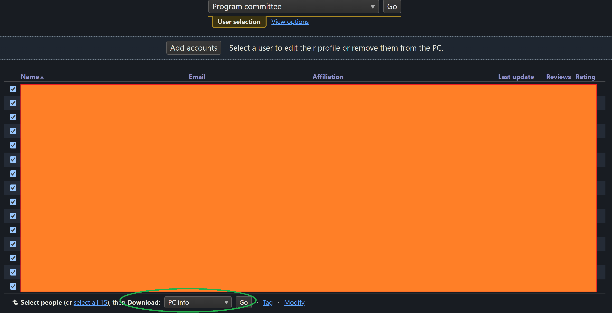
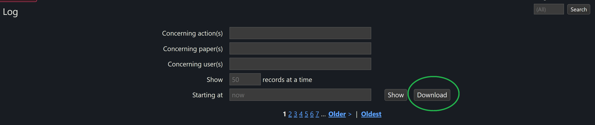
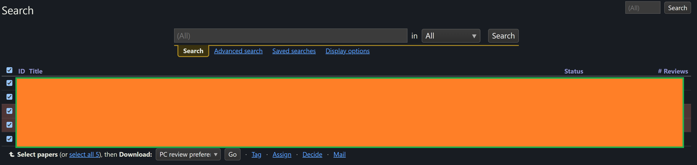
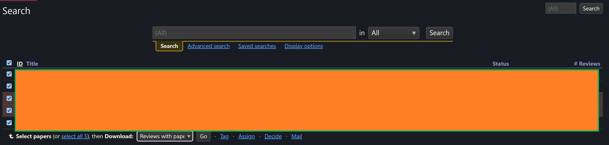

# HotCRP PC Activity Analyzer

A small, **offline** Python pipeline for extracting and summarizing Program Committee (PC) activity from [HotCRP](https://hotcrp.com/) exports. It combines PC profiles, bids, assignment logs, and review/comment text into reproducible reviewer-level metrics: reviewing activity, word counts, timeliness, and discussion participation.

The intention is to compute quantifiable metrics usable to identify PC members that particularly distinguished themselves among the PC.

## Getting started

Requires **Python 3.10+**. The main pipeline uses only the Python standard library.

1. Clone the repository (and install `requirements.txt` if you want to use notebooks)
2. Retrieve data from HotCRP (note: only PC chairs / admins can do so)
3. In `code/main.py`, configure `MIN_REVIEWS`, `ROUND_STARTS`, and `DEADLINES` for the venue. Round dates must include UTC offsets. Optionally adjust the emergency grace period and word-count thresholds.
4. From the project root, run:

   ```bash
   python code/main.py
   ```

Alternatively, pass paths and configuration on the command line (`python code/main.py --help`). Command-line settings take precedence over the editable defaults in `main.py`.

## Data acquisition

The main pipeline takes a PC roster (`*pcinfo*.csv`), paper preferences (`*allprefs*.csv`), an activity log (`*log*.csv`), and the all-reviews/comments text export (`*reviews*.txt`). The filename patterns are used for automatic discovery; explicit paths can be supplied instead.

To get what is needed, you must go to the HotCRP webpage of the venue you are a PC chair of (only PC Chairs, or admins, have the admins right to get all data required to run the scripts). Let https://sampleVenue.hotcrp.com be the instance of reference.

### PC Info

The first thing you must get are the details of all PC members. These details are necessary to understand the names and email addresses of the PC members, used for the subsequent associations; but it is also needed to infer whether the PC members have set their "topics" which facilitate paper assignment. 

Just go to https://sampleVenue.hotcrp.com/u/0/users/pc, and then select all PC members, select Download (at the bottom) and choose "PC Info". Save the file in ``data\sampleVenue-pcinfo.csv``. An image is below


### Logs

Next, you must get the logs. These are necessary to map timestamp data with reviews and comments. 

Just go to https://sampleVenue.hotcrp.com/u/0/log and click on "Download". Save the file in ``data\sampleVenue-log.csv``. An example is below


### Preferences (bids)

Now, you must download the file including details on the preferences each PC member placed on the papers submitted---also known as "bids". Bidding is paramount to ensure good matching and, hence, high-quality reviews. 

Just go to https://sampleVenue.hotcrp.com/u/0/q=&t=all, select all submissions, and click "Download", choose "PC review preferences", and click "Go." Save the resulting file in ``data\sampleVenue-allprefs.csv``. An example is below


### Reviews and Comments

Finally, you must download the reviews and comments. This is to infer the length of the reviews written by each PC member, as well as how many comments (and how long they are) they have posted across all submissions. 

From the same page as before (https://sampleVenue.hotcrp.com/u/0/q=&t=all) select all submissions, and click "Download", choose "Reviews with paper info", and click "Go." Save the resulting file in ``data\sampleVenue-reviews.txt``. An example is below


### Firefighters and upvotes

Other (quantifiable) signals of noteworthy PC members are the "upvotes" received and whether they contributed "emergency" reviews (also known as "firefighters"). It is hard to systematically obtain these from HotCRP, but you are invited to do so (e.g., you can use Tags for emergency reviews, and you can get upvotes by copy-pasting the entire PC, as rendered in the browser, onto an Excel table, as this will report the upvotes in a table which you can then quickly convert to a CSV). 

## Try the synthetic example

The `sample_data/` directory contains **entirely invented** files for the fictional venue `sampleVenue`. The example has 8 fictional PC members, 9 submissions, 29 submitted reviews, and 25 comments (including chair comments). It tests topic completion, positive/zero/negative bids, discussion initiation, ordinary late reviews, and emergency-assignment deadline exceptions.

Run the example from the project root with the sample's **two-round** schedule:

```bash
python code/main.py --input-dir sample_data --output-dir sample_output --min-reviews 2 3 --round-starts "2026-07-01T00:00:00-12:00" "2026-07-25T00:00:00-12:00" --deadlines "2026-07-20T23:59:59-12:00" "2026-08-10T23:59:59-12:00"
```

The additional ``sampleVenue-firefighters.csv`` and ``sampleVenue-upvotes.csv`` files contain synthetic manual annotations for separate notebook-based evaluations; ``main.py`` does not read them. To use those notebook cells, set their CSV path variables to these files.

## Outputs

The main outputs are created in `output/` (or the directory selected with `--output-dir`):

- **`pc_metrics.csv`** — one row per eligible PC member, with review, comment, bid, timing, and discussion metrics.
- **`pc_metrics_summary.json`** — aggregate statistics, processing configuration, discussion-initiation audit, and warnings.

Intermediate annotated CSV and extracted JSON files are retained to support auditing and troubleshooting. No award-recipient list is generated by `main.py`.

## Repository layout

```text
.
├── README.md
├── code/              # main.py and the five extraction/metrics modules
├── data/              # HotCRP exports for the actual venue (private)
├── sample_data/       # fictional sampleVenue input files
└── output/            # generated locally
```

## Confidentiality

All processing runs locally: **no network requests, external services, or AI-based analysis** are used by the pipeline. Outputs are deterministic.
