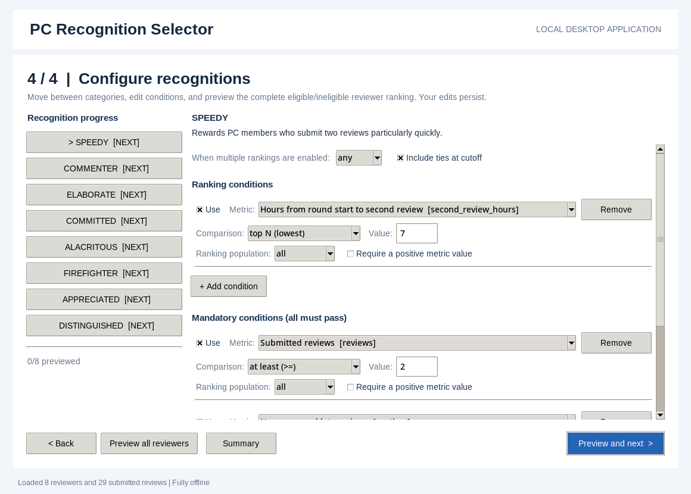
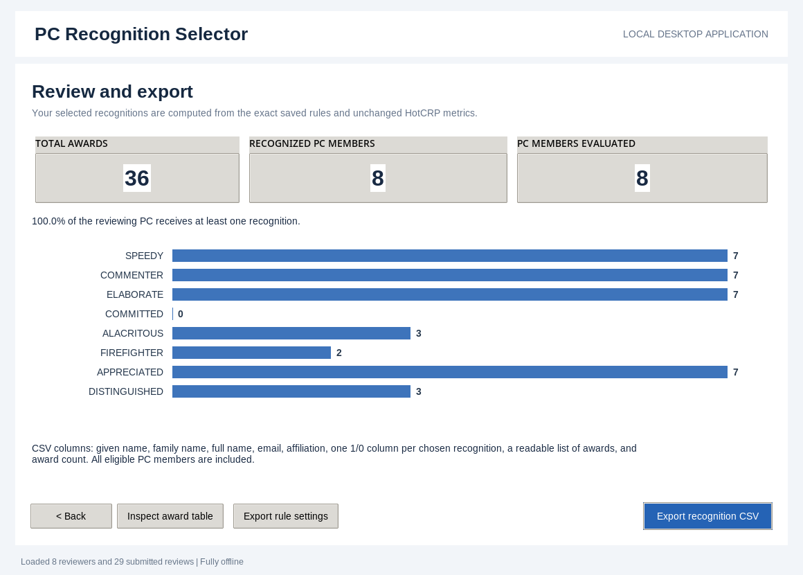

# Native PC Recognition Selector

A **fully offline**, deterministic native desktop GUI for the HotCRP PC Activity Analyzer. The app uses the **existing** `code/main.py` extraction and `pc_metrics.py` time/discussion calculations. It is a new folder alongside `code/`, not a replacement for the five-stage command-line pipeline. No LLM, hosted service, account, telemetry, or browser server is required.

## Download and open the application

Download the appropriate archive from [the repository's Actions artifacts](../actions/workflows/build-desktop.yml) (for maintainers) or the release assets (when a release has been published):

| Operating system | Build output | How to launch |
|---|---|---|
| Windows 10/11, x64 | `PCRecognitionSelector-windows-x64.zip` | Extract the entire folder, double-click `PCRecognitionSelector.exe` |
| macOS Apple Silicon | `PCRecognitionSelector-macos-arm64.zip` | Unzip, open `PCRecognitionSelector.app` |
| macOS Intel | `PCRecognitionSelector-macos-intel.zip` | Unzip, open `PCRecognitionSelector.app` |
| Linux, x64 | `PCRecognitionSelector-linux-x64.tar.gz` | Extract and open the `PCRecognitionSelector` executable inside its folder (requires a graphical desktop; executable permissions should be preserved) |

**Do not move the `.exe`/Linux executable out of its extracted folder:** PyInstaller includes supporting libraries next to the launcher. Each platform has its *own* standalone download; the same binary cannot run on all three platforms. A macOS app downloaded from an unsigned project may trigger Gatekeeper; the user may have to authorize running the app using the system's security controls. Windows SmartScreen may likewise display a warning for an unsigned executable. These builds are not notarized or code-signed.

The workflow [`.github/workflows/build-desktop.yml`](../.github/workflows/build-desktop.yml) is executed on native Windows, macOS Intel, macOS Apple Silicon, and Linux GitHub-hosted runners. Downloadable build artifacts are retained for 30 days. On a *published GitHub release*, the same assets are attached automatically to that release. GitHub Actions must be enabled for your fork/repository.

## Run directly from source (Python 3.10+)

With Python and Tk installed, from the **repository root**:

```bash
python desktop_app/launch.py
```

Convenience source launchers are also provided: `desktop_app/start_windows.bat`, `desktop_app/start_macos.command`, and `desktop_app/start_linux.sh`. They require Python to be installed; **only packaged release executables are self-contained**.

On some Linux distros, Tk is a separately installed OS package (e.g., `python3-tk`). Python itself has no pip dependencies for the GUI or core pipeline. For offline wheel-free source use this launcher instead of the notebook, which requires a separate data-analysis environment.

## Screenshots (synthetic sample only)





## Step-by-step interface

1. **HotCRP instructions:** a page explains how to download the four exports, which requires HotCRP administrative permissions.
2. **Choose files:** browse to the four required exports: PC info (`.csv`), paper preferences (`.csv`), activity log (`.csv`), and reviews-with-paper-info (`.txt`). Optionally provide supplementary data (below). By default, PC-info rows with the HotCRP `chair` role are excluded from ranking; other zero-review PC members are kept.
3. **Configure rounds:** add or remove rounds, setting their start, deadline, and discussion threshold. Timestamps must include UTC offsets (e.g. AoE `-12:00`). Also configure assignment grace days and minimum review/comment lengths. **Important:** the pipeline links discussion windows and round thresholds. Adding a round can change discussion-attribution counts; this is not an inference about emergency reviews.
4. **Process:** the original five-stage pipeline runs in a temporary directory. The review metrics and event lists remain available in the app's memory; nothing is uploaded. Restarting the analysis deletes its preceding temporary outputs.
5. **Choose recognitions:** tick any of the eight categories. Each has a short description.
6. **Edit one recognition at a time:** edit existing rules (thresholds/operators), disable rules with `Use`, remove them entirely, or add new metrics. All mandatory rules are combined with AND. Ranked categories may match ANY or ALL of their configured ranking conditions. Distinguished assigns one point per enabled scored rule with a configurable threshold. Review a full ranking of **all PC members** for every category, not merely award winners. A left-side progress indicator shows which categories have been previewed, and you can move backward or forward without resetting your edits.
7. **Inspect summary:** the app visualizes total awards, unique recognized PC members, total PC members and recipient counts by recognition. Confirm the choices, inspect the full award table and export a UTF-8 BOM CSV (Excel-compatible). You can optionally save a JSON audit of the exact thresholds and round settings (without private file paths or PC data).

The exported CSV contains `given_name`, `family_name`, `name`, `email`, `affiliation`, a `0`/`1` column for each **chosen** recognition, `recognitions` (pipe-separated), and `award_count`. All eligible PC members are exported, including those receiving zero awards. The output order is deterministic: family name, given name, email. Cells beginning with spreadsheet formula prefixes are escaped to avoid CSV formula injection when opened in Excel.

## Recognitions and initial settings

The eight defaults implement the final AISec '26 definitions:

| Award | Default conditions |
|---|---|
| SPEEDY | Top 7 *smallest hours to second submitted review*, with at least 2 reviews and no unexcused lateness |
| COMMENTER | Top 7 by total comment wordcount **OR** top 7 by number of comments (union; ties are included) |
| ELABORATE | Top 7 by cumulative review wordcount, with reviews and no unexcused lateness |
| COMMITTED | At least 10 paper bids, an explicit preference for **every available topic**, at least 2 submitted reviews, no unexcused lateness |
| ALACRITOUS | Initiated discussion on at least 2 *distinct* papers (including chair-certified verified minimums) |
| FIREFIGHTER | At least 2 **ordinary** reviews plus at least 1 extra review, based exclusively on externally supplied email/paper pairs |
| APPRECIATED | Top 7 received upvotes among members with submitted reviews, including ties |
| DISTINGUISHED | At least **8/12** independently satisfied criteria (bids, all topics, timeliness, number of comments top 30%, review count, average review length top 30%, upvotes top 30%, discussion initiation, ordinary reviews >=48 hours early, extra review, spotlight vote, cumulative comment wordcount top 30%). |

These are **starting settings, not hard-coded obligations**. You can switch to 5/6 topics by disabling the `Preferences for ALL topics` requirement and adding `Topic preferences explicitly set >= 5`. For Distinguished, you can remove or add scored criteria. You can modify the ranking pool (`all` or `reviewed`) and tie policy. The 48-hour early-review criterion uses a directly editable number rather than a fixed Boolean.

**Strict supplementary input policy:** if a selected recognition depends on upvotes, firefighter assignments, or spotlight voting but the necessary source was not provided, the preview gives a clear error; it **never silently substitutes zero or infers the missing data**. Disable that criterion or supply the relevant file. The original `pc_metrics.py` itself remains responsible for timeliness, review length and automatic discussion attribution; the GUI does not invent any review activities.

### Supplementary input formats

All files are local and optional. Names are arbitrary: choose any file path through the GUI.

- **Firefighter/extra reviews CSV**: `email,paper` with an optional `notes` column. One reviewer can have many rows. Only submitted email/paper pairs are accepted. No date-based inference.
- **Upvotes CSV**: `email,#upvotes`. Signed integer totals (negative, zero, positive); blanks mean zero. One reviewer per row. A known chair's vote row is ignored if chair accounts are excluded.
- **Spotlight votes**: one email address per line, optionally a one-column CSV with `email` heading. Also supports a literal list such as `voted = ["a@example.org"]`.
- **Deadline exceptions**: one email address per line. These are **chair-certified** exceptions for proactive notification followed by honoring a self-imposed due date. They alter *award-effective timeliness*, not the original delay metric. They do not automatically award a 48-hour-early point.
- **Discussion corrections CSV**: `email,minimum_distinct_papers` for manually verified initiated discussions. The effective count is the **maximum** of the automated count and this confirmed minimum; no double-counting.
- **Upvote corrections CSV**: `email,#upvotes`. Overrides just those reviewers, preserving the original full upvotes list elsewhere.
- **Email aliases**: optional pairs, entered in the GUI as `alias@example.org,canonical@example.org`, separated by semicolons. The target must match the original PC-info roster; unknown emails cause an error rather than being ignored.

Missing upvotes are treated as zero **only if the main upvote file is supplied**. In the absence of that file, upvote ranking/scoring is unavailable, and the GUI requires you to disable related criteria or provide the file. The same policy applies to firefighter and spotlight data.

## Transparency, reproducibility, and confidentiality

- **Fully local:** the GUI uses only Python, Tkinter, the repository's existing code, and locally selected files. No network client, ML/LLM, remote calls, accounts, or analytics.
- **Deterministic outputs:** consistent parsing, stable email normalization, sorted exports, and tie-handling rules. Same inputs + rules = same outputs.
- **Source traceability:** original PC metrics/late flags are left unchanged; chair exceptions and corrections are a separate input. The preview exposes each active rule and the supporting metric values.
- **Ephemeral processing:** intermediate files live in a `tempfile.TemporaryDirectory`, normally deleted when the user closes the app. Exported CSV is placed wherever the user chooses; do not distribute raw HotCRP data casually.
- **Changes in methodology:** customizing recognition conditions may change what an award *means*; record the configured thresholds in your paper/workshop summary. The app does not automatically claim that a newly customized award follows the AISec conventions.

## Test and build locally

```bash
python -m unittest discover -s desktop_app/tests -v
python -m pip install "pyinstaller>=6.11,<7"
python -m PyInstaller --clean --noconfirm --onedir --windowed --name PCRecognitionSelector --paths code --paths . desktop_app/launch.py
```

A native build should be performed **on its intended operating system**. A Linux runner cannot produce a correctly packaged native macOS `.app` or Windows `.exe` using ordinary PyInstaller. Use the GitHub Actions workflow instead. The build bundles a Python runtime, Tk/Tcl libraries, and the five-stage extraction pipeline; users of packaged binaries do **not** need to install Python.

### Test with bundled synthetic files

`sample_data/` contains entirely fictional HotCRP exports for `sampleVenue`, plus example firefighter/upvote/spotlight inputs. You can point the GUI file selection at these files for a safe test run. The sample has **three** reviewing topics, so the default *all topics* rule applies to 3/3, not the AISec-specific 6/6.
